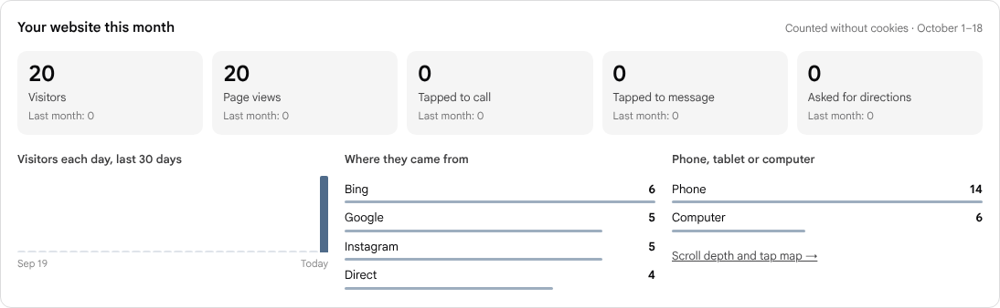
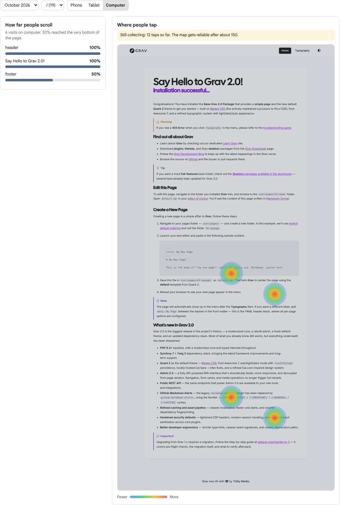

# Visitor Insights for Grav

Cookie-free visitor numbers for Grav 2, shown on the Admin2 dashboard. Visitor Insights counts visitors and page views, shows where they came from, records taps on the links that matter (call, message, email, WhatsApp, directions, social, downloads), and shows how far down each page people scroll, with a tap heatmap drawn over a live preview of the page.

It sets no cookies, sends nothing to a third party and never writes an IP address to disk. The only thing it ever stores in a browser is the opt-out flag you can set on your own browser, so no cookie banner is needed.

The plugin does still process IP addresses briefly, in memory, to tell one visitor from another, so it is worth a mention in your privacy notice. A line such as "We count visits with a privacy-friendly tool that sets no cookies and doesn't store IP addresses" is usually enough. This is not legal advice; check what applies where you are.





## Features

- **Visitors and page views** for this month and last month, plus a chart of the last 30 days.
- **Where visitors came from**: search engines, social sites, AI assistants (ChatGPT, Claude, Perplexity, Gemini, Copilot), Google Maps, `utm_source` campaigns (QR codes, flyers, newsletters) and direct visits.
- **Phone, tablet or computer.**
- **Taps that matter**: `tel:`, `sms:`, `mailto:`, WhatsApp, map and directions links, social profiles and file downloads are recognised automatically. Add `data-insights="booking"` to any link or button to track your own.
- **Scroll depth per section**: the share of visits that reached each `header`, `section` and `footer` of a page.
- **Tap heatmap**: taps are stored relative to the section they landed in, so the map lines up with the page even when the layout changes between screen sizes. The admin page shows phone, tablet and computer separately.
- **A dashboard widget and an admin page**, both behind their own permission (`api.insights.read`). You can give clients the numbers without giving them anything else.

## How visitors are counted without cookies

Each visit is identified by a one-way hash of the IP address, the browser's user agent and a random salt. The salt is replaced every day and the old one is deleted, so the same person can't be linked from one day to the next and the hashes can't be reversed. Plausible and Fathom use the same method. The day's list also counts how many visitors each IP address has added, keyed by a salted hash of the address, never the address itself. The list is deleted when the day ends. Only the totals are kept, in one JSON file per month.

## Telling people from bots

A view is only counted once the visitor engages with the page: it has been visible for 2 seconds (you can change this), or the visitor scrolls, taps or presses a key. Most bots never do any of that. On top of that:

- known crawlers, monitoring tools, HTTP libraries and headless browsers are filtered out by user agent;
- browsers driven by automation (`navigator.webdriver`) are ignored;
- behind Cloudflare, requests with a low bot score are dropped;
- one visitor can add at most 50 views a day (you can change this);
- one IP address can add at most 20 new visitors a day (for IPv6, one /64 network), so a script that changes its user agent on every request can't invent visitors. Anyone already counted carries on as normal. On a very busy day this can undercount people who share one connection, such as an office or a school;
- a day's visitor list holds at most 10,000 entries. Past that, no new visitors are counted until the next day;
- taps and scroll data are only accepted from visitors who were already counted;
- one visitor can add at most 100 taps and scroll reports a day (you can change this), so a single browser can't flood the tap counts or the tap map;
- views and scroll data are only counted for pages that really exist on the site: the browser reports its own path, so made-up paths are dropped;
- a day lists at most 50 sources, 500 pages and 50 tap names, and anything beyond that is counted as "Other", so a flood of invented referrers, paths or names can't fill the data folder;
- a page keeps scroll and tap data for at most 60 sections on each device.

## Respecting visitors

- Global Privacy Control is honoured by default. Do Not Track can be honoured too.
- Visit any page with `?insights-ignore=1` to stop your own browser being counted, and with `?insights-ignore=0` to undo it. The flag is kept in that browser's local storage.
- Data older than 13 months is deleted automatically (you can change this).

## Speed

The browser script is under 2 KB gzipped, loads with `defer` and sends one small request after engagement and one when the visitor leaves. Page rendering isn't affected.

On the server, every hit reads the month's file, changes it and writes it back in full, under a lock, so hits are recorded one at a time. The file grows with the number of pages that have scroll and tap data. Measured on a laptop SSD:

- a 50-page site at the end of a busy month (a month file of about 0.5 MB): about 15 ms a hit, and about 80 hits a second when many arrive at once;
- 500 pages with scroll and tap data, the most a month holds (about 5 MB): about 140 ms a hit, and about 7 hits a second.

That suits small and medium sites. If yours regularly gets several hits a second, or has hundreds of pages that people scroll and tap, requests will queue behind the lock and a database-backed analytics tool is a better fit. The plugin also stops counting new visitors for the rest of the day once 10,000 different visitors have been seen.

## Requirements

- Grav 2.0 or later
- The [API plugin](https://github.com/getgrav/grav-plugin-api) 1.0.40 or later
- [Admin2](https://github.com/getgrav/grav-plugin-admin2) 2.0.0 or later. Installing or updating Visitor Insights with GPM installs it if it isn't there already
- PHP 8.3 or later

## Installation

With GPM, once the plugin is listed on getgrav.org:

```
bin/gpm install visitor-insights
```

Or by hand: download this repository, unzip it into `user/plugins/visitor-insights`, and clear the cache.

Your theme has to output Grav's assets, which almost every theme does: `{{ assets.js()|raw }}` in the page template, or `{{ assets.js('bottom')|raw }}` if the theme loads scripts at the end of the page.

## Who can see the numbers

Super users always can. To let anyone else see them, give their account or group the **Visitor insights** permission (`api.insights.read`), alongside `api.access`. They then see the dashboard panel and a **Visitor insights** item in the sidebar.

## Configuration

Settings are in Admin2 under Plugins → Visitor Insights, or in `user/config/plugins/visitor-insights.yaml`:

```yaml
enabled: true
route: /visitor-insights/hit        # where the script sends its hits
count_after_seconds: 2              # 0 counts every view straight away
respect_gpc: true
respect_dnt: false
daily_view_cap: 50                  # views one visitor can add per day
daily_action_cap: 100               # taps and scroll reports one visitor can add per day
heatmaps: true                      # scroll depth and the tap map
sections: 'header, main > section, section, footer, [data-insights-section]'
retention_months: 13
exclude_routes: []                  # for example ['/private/*']
ignore_param: insights-ignore
trust_cloudflare_ip: false          # only when the site is behind Cloudflare
```

### Behind a proxy or load balancer

The plugin takes the visitor's IP address from Grav, so it follows Grav's own proxy settings in `user/config/system.yaml`. Behind a proxy that sets `X-Forwarded-For`, turn on `http_x_forwarded.ip`; behind Cloudflare, `http_x_forwarded.cf_connecting_ip`. Only turn one on when every request really comes through that proxy, because otherwise visitors can fake the header. Without it, everyone appears to come from the proxy's address, and the limit of 20 new visitors per address applies to the whole site.

`trust_cloudflare_ip` reads Cloudflare's header for this plugin only, whatever Grav's settings say. The same warning applies: the header can be faked unless your server only accepts traffic from Cloudflare.

## Marking up your pages

None of this is required. The defaults work with most themes.

- `data-insights="name"` on a link or button counts taps on it as `name`.
- `data-insights-section="key"` turns any element into a section for scroll depth and the tap map, with a stable key.
- `data-insights-label="Our menu"` gives a section a readable name. Otherwise its first heading is used.

### Finer tap maps

Taps are placed on a 20 by 20 grid inside the section they land in, so a map is only as fine as the page's sections. Some themes wrap the whole page body in one `<section>`; Quark2, Grav's default theme, does. The tap map then has one section the length of the page, and on a 2,400px page each grid row covers about 120px.

To get finer maps, mark the blocks of your pages yourself, in the theme's templates or in page content:

```html
<div data-insights-section="intro" data-insights-label="Introduction">…</div>
<div data-insights-section="prices" data-insights-label="Prices">…</div>
<div data-insights-section="contact" data-insights-label="Contact us">…</div>
```

A block inside another section is skipped, so the outer `<section>` would still win. Take `section` out of the **Page sections** setting, for example `header, [data-insights-section], footer`.

## Data

Everything is stored in `user/data/visitor-insights/`:

- `insights-YYYY-MM.json` holds a month's totals;
- `visitors-YYYY-MM-DD.json` (salted hashes of today's visitors, and how many each IP address has added, keyed by a salted hash of the address) and `salt-YYYY-MM-DD.txt` exist for the current day only.

Delete the folder to start again.

## Development

```
composer install
vendor/bin/phpunit
```

## Licence

MIT. See [LICENSE](LICENSE).
